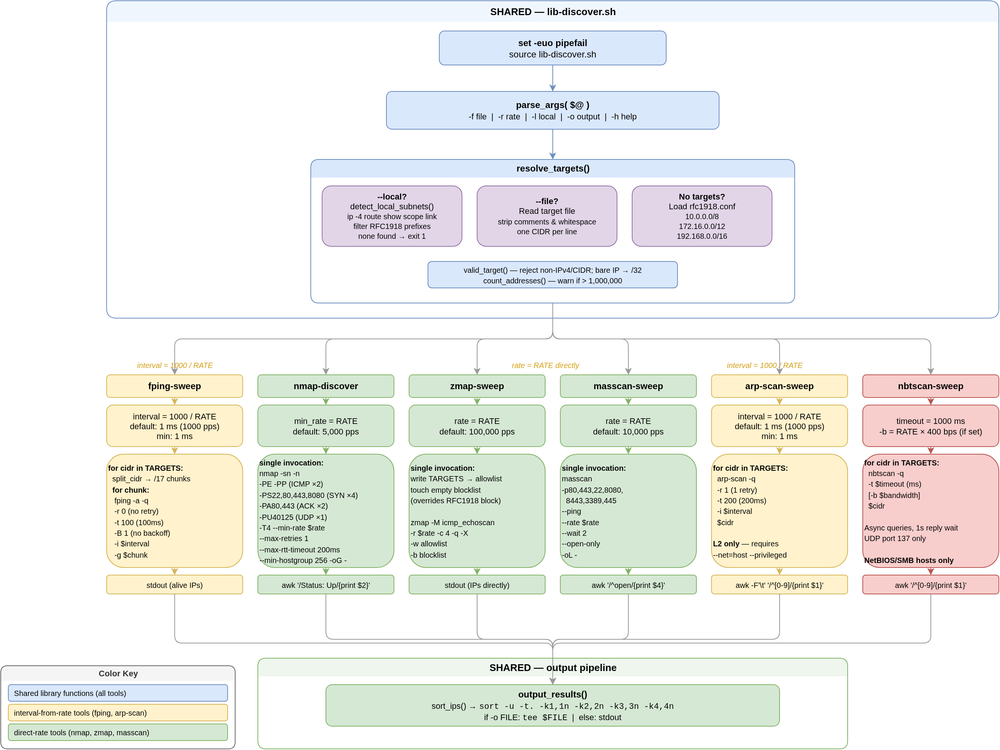
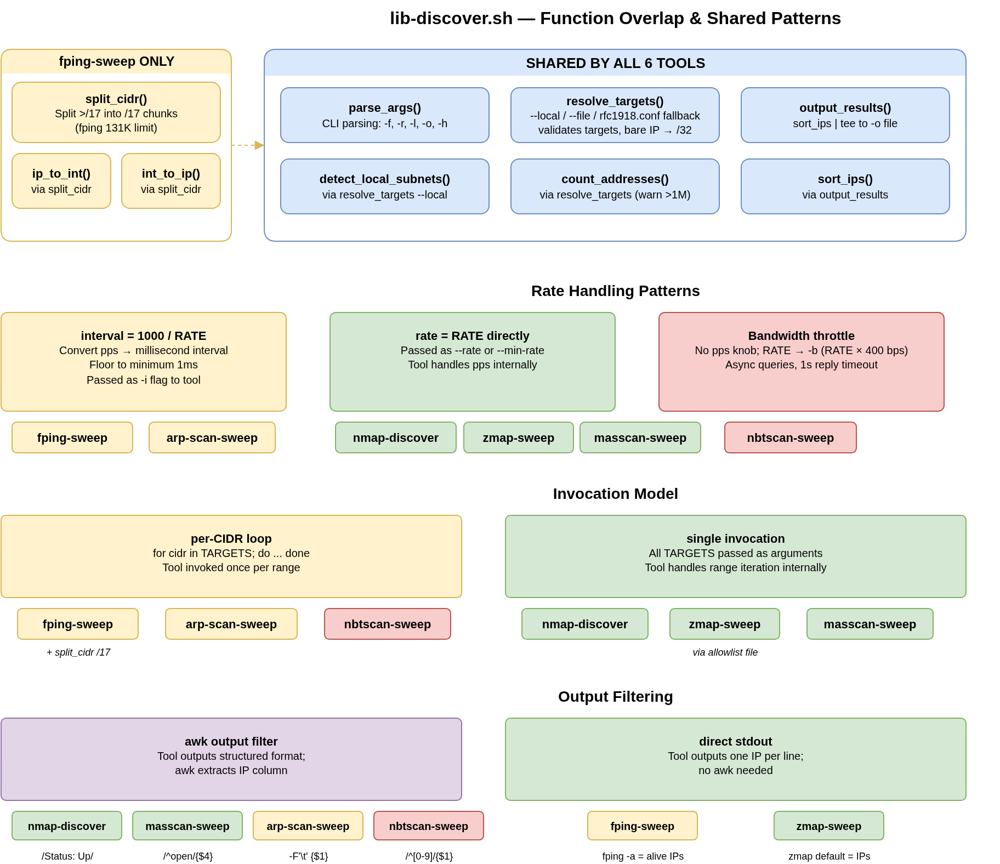

# Architecture

Each tool is a thin bash wrapper that sources `bin/lib-discover.sh` for argument parsing, target resolution, and sorted output. Sources for the diagrams are the `.drawio` files alongside the PNGs.

## Execution Flow

## Shared Patterns

